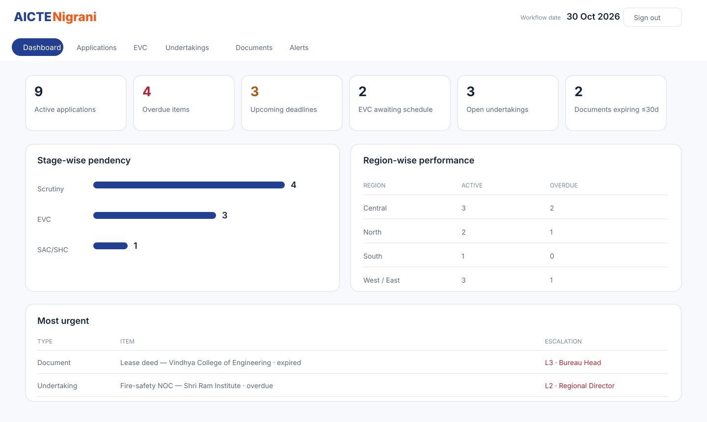
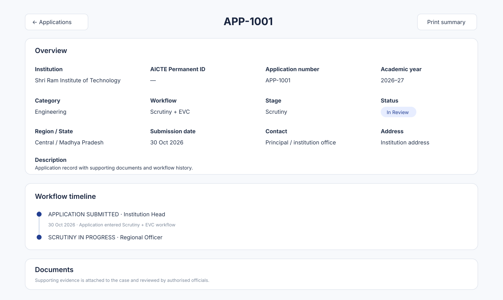
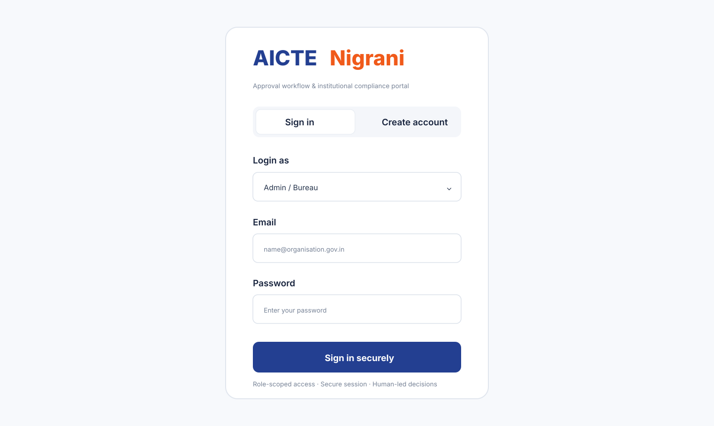
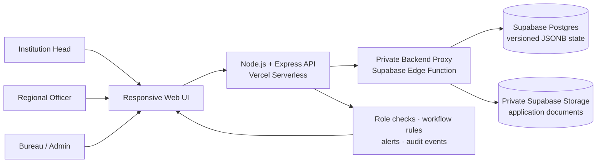

<div align="center">
  
  <h1>AICTE Nigrani</h1>
  <p><strong>One Engine for Every Approval & Deadline</strong></p>
  <p>SIH 2026 · Problem Statement <strong>SIH26262</strong> · Team <strong>Aayam</strong> · Team ID <strong>197726</strong></p>
  <p><a href="https://aictc-nigraani.vercel.app"><strong>Live Prototype</strong></a> · <a href="https://aictc-nigraani.vercel.app/healthz">Service Health</a> · <a href="SIH_SUBMISSION.md">SIH Solution Brief</a> · <a href="docs/EVALUATOR_DEMO.md">Evaluator Demo</a></p>
  <p>    </p>
</div>

---

## The problem we are solving

AICTE approval work includes multiple application pathways and processing stages, including scrutiny, Expert Visit Committee (EVC), SAC/SHC and other combinations prescribed by the applicable Approval Process Handbook (APH). In parallel, institutions may have time-bound undertakings and prescribed documents—such as lease documents—that require submission, verification and renewal. Fragmented follow-up makes it difficult to identify stalled applications, approaching deadlines, overdue compliance and the official responsible for the next action.

**AICTE Nigrani brings application movement and institutional obligations into one role-aware workspace.** It helps teams see what is pending, who owns the next action, why a case was returned, and what needs attention before a deadline is missed.

## Product preview

| Role-based workspace | Application case file |
|---|---|
|  |  |
| **Escalation and alerts** | **Sign-in and registration** |
|  |  |

[Open the live prototype](https://aictc-nigraani.vercel.app) · [Read the evaluator guide](docs/EVALUATOR_DEMO.md)

## What makes the solution distinctive

### 1. Unified Obligation Engine
A single operational view connects approval-stage clocks, EVC scheduling, undertaking due dates and lease/document expiry. Instead of maintaining separate follow-up lists, each obligation has a status, due date, responsible role and next action.

### 2. Explainable document assistance — human confirmed
The proposed solution can extract candidate dates and flag missing or inconsistent evidence from uploaded documents. Any extracted value must be shown with its source and confidence and confirmed by an authorised officer. **AI does not approve, reject, inspect or certify an institution.** Automated OCR/AI extraction is a roadmap item, not a claim of a currently deployed production model.

### 3. Deadline-led alerts and escalation
The SIH concept proposes T-30 and T-7 reminders, due-date notices and overdue escalation. The current prototype demonstrates upcoming/overdue alert calculations, escalation labels and an evaluator date simulator. Actual email/SMS dispatch and a live scheduler are not configured in this demo.

### 4. Explainable, traceable workflow
Stage completion, returns, resubmissions, EVC scheduling and compliance actions are represented in application history and the audit log. Returns require a reason. Final statutory decisions stay with competent authorities.

## Prototype capabilities

- **Role-based access:** Bureau/Admin, Regional Officer and Institution Head; server-side region/institution scoping.
- **Open evaluator onboarding:** Regional Officers and Institution Heads can self-register and sign in immediately. Admin/Bureau accounts cannot be self-created. Institution email domain must match the declared website domain; this is a consistency check, not verified domain ownership.
- **Configurable workflow paths:** Only Scrutiny, Scrutiny + EVC, Only EVC, Only SAC/SHC, Scrutiny + SAC/SHC, EVC + SAC/SHC, and Scrutiny + EVC + SAC/SHC.
- **Application movement:** stage progression, authorised return/revert with reason, resubmission and application timeline.
- **Pendency and workload visibility:** stage-wise ageing, overdue queues and region-wise dashboard summaries.
- **EVC coordination:** EVC queue, scheduling action and visibility of unscheduled EVC-stage cases.
- **Institutional compliance:** undertaking submission/verification states and lease/document validity/renewal states.
- **Document handling:** drag-and-drop uploads, file signature/type validation, private Supabase Storage and authorised preview/download.
- **Alerts and reporting:** upcoming/overdue alert views, escalation levels and CSV export.
- **Governance:** hash-chained audit events, role/scope checks and human-authority safeguards.

## Architecture at a glance



| Layer | Implementation |
|---|---|
| Web interface | Responsive HTML, CSS and JavaScript |
| API | Node.js 22 + Express on Vercel |
| Persistent application state | Supabase Postgres JSONB singleton with version-checked writes |
| File storage | Private Supabase Storage bucket, accessed through a server-side proxy |
| Authentication | scrypt password hashes; HS256 session cookie; login throttling |
| Governance | Server-side role/region/institution checks, application history and hash-chained audit log |

More detail: [Architecture and data flow](docs/ARCHITECTURE.md) · [Requirement-to-feature traceability](docs/FEATURE_TRACEABILITY.md) · [Security and limitations](docs/SECURITY_AND_LIMITATIONS.md).

## Run locally

Requirements: Node.js 22 and npm.

```bash
git clone https://github.com/nikhilkumar200408/aictc_nigraani.git
cd aictc_nigraani
npm ci
npm start
```

Open `http://localhost:3000`. In local development, demo accounts are seeded with password `Aicte@2026` unless `DEMO_PASSWORD` is set. Use the role dropdown to select the matching role. Demo accounts and sample records are for local evaluation only; do not reuse their credentials in production.

## Configuration and deployment

The hosted prototype uses Vercel for the Express application and Supabase for persistent state and private document storage. Configure the following as **server-side Vercel environment variables**; never expose service credentials in browser code or commit them to Git:

- `NODE_ENV=production`
- `SUPABASE_URL`
- `APP_BACKEND_URL`
- `APP_BACKEND_SECRET` (sensitive)
- `SUPABASE_BUCKET=application-documents`
- `JWT_SECRET` (random, at least 32 characters)
- `BOOTSTRAP_ADMIN_EMAIL`
- `BOOTSTRAP_ADMIN_PASSWORD` (12+ characters; sensitive)
- `BOOTSTRAP_ADMIN_NAME` (optional)
- `DEMO_HINT=0`

The Supabase project must have the `app_state` table, version-checking `save_app_state` RPC, private Storage bucket and backend proxy function configured. Keep secrets in Vercel/Supabase secret settings, not in `.env.example`, source files, screenshots or PPTs.

## Test and quality checks

```bash
npm ci
npm test
node --check server.js
```

GitHub Actions runs the automated test suite and JavaScript syntax check on pushes and pull requests to `main`. See the [CI workflow](.github/workflows/ci.yml).

## Evaluator quick path

1. Open the [live prototype](https://aictc-nigraani.vercel.app).
2. Register a Regional Officer or Institution Head account (12-character minimum password) or use the configured evaluator credentials supplied separately by the team.
3. Open the dashboard and compare the role-scoped view.
4. Explore Applications, open a case, inspect its timeline and demonstrate a reasoned return/stage action where permitted.
5. Explore EVC, Undertakings, Documents and Alerts; use the Bureau date simulator to demonstrate ageing and escalation.
6. Review the [feature traceability matrix](docs/FEATURE_TRACEABILITY.md) alongside the SIH26262 requirements.

**Important:** The live dataset contains illustrative prototype records. Do not enter real personal, institutional or confidential regulatory data into this evaluation deployment.

## SIH alignment and regulatory boundary

This repository is organised around **SIH 2026 · SIH26262 — Integrated AICTE Approval Workflow Automation, Compliance Monitoring and Alert Management System**. The proposed platform supports—not replaces—official processing. Before real-world adoption, the competent authority must validate current APH pathways, SLAs, delegation rules, document checklists, escalation policy, data-retention rules, identity verification and integrations. No automated recommendation or workflow transition is a statutory approval or rejection.

## Team

**Aayam · Team ID 197726 · SIH 2026**

For a guided walkthrough, start with [docs/EVALUATOR_DEMO.md](docs/EVALUATOR_DEMO.md).
