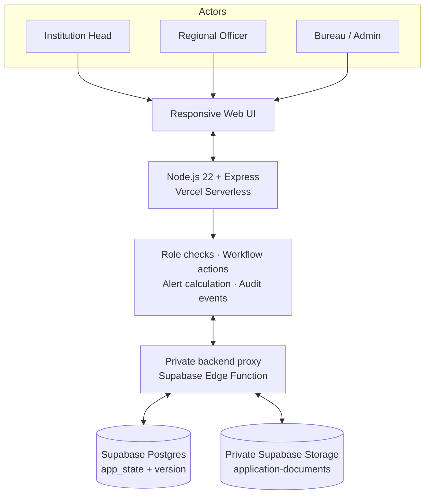

# Architecture and Data Flow

## System context

## Main request flows

### Authentication and role scoping

1. User signs in with email, password and selected role.
2. Password verification uses Node.js `scrypt`; successful sign-in issues an HS256 token in an HttpOnly, SameSite cookie.
3. Authenticated API handlers resolve the user from server-side state.
4. Role checks scope application, undertaking and document records to Bureau, assigned Region or assigned institution.

### Application workflow

1. Institution Head creates an application and selects a supported workflow path.
2. The application stores its current stage index and stage-start offset.
3. An authorised officer completes a stage or returns the case with a mandatory reason.
4. Institution responds to a returned case and resubmits.
5. Each action appends application history and an audit event.

### Compliance and documents

- Undertaking and document records carry due/expiry offsets and workflow states.
- Institution-side submission actions and official verification actions are role-gated.
- Application evidence files are checked by extension, MIME type and file signature, assigned a checksum, and stored in a private bucket.
- Document download/preview is served only after authenticated application-scope checks.

### Persistence

- Application state is stored as JSONB in a singleton `app_state` record.
- A version-aware database RPC (`save_app_state`) provides optimistic concurrency control. A conflicting write should be reloaded and retried by the user rather than silently overwriting another update.
- The Express API calls a private backend proxy; Supabase service credentials stay server-side.

## Workflow and alert logic

The shared `public/logic.js` module contains workflow paths, stage SLA values, alert levels and audit-chain verification. The current demo uses a simulated workflow-day offset so evaluators can reproduce approaching/overdue cases. Before real use, all paths, SLA values, alert thresholds and escalation roles must be approved against the current APH and administrative delegation matrix.

## Proposed extension points

- Scheduled alert runner plus approved email/SMS provider.
- OCR pipeline for lease/undertaking documents, returning candidate fields with source page, confidence and human confirmation.
- Versioned APH/rule configuration with effective dates and change approval.
- Approved integrations with AICTE systems, eOffice, DigiLocker or API Setu where access and legal authority exist.
- Normalised relational schema and queue/event processing if transaction volume grows beyond the current prototype state-store model.
